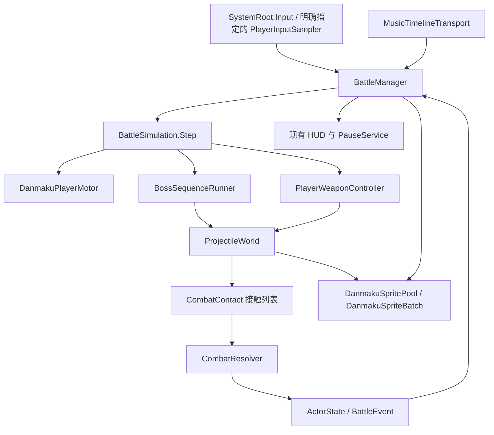

# 战斗第一阶段与音频解析：接入说明

2026-10-11 规则更新：所有有效弹幕伤害固定为 1、一次命中回收；Boss 血量、受伤与碰撞已取消，玩家子弹穿过 Boss。歌曲实际结束或角色倒下统一进入歌曲结算。旧阶段未实现项为历史记录，当前入口与规则见[弹幕编辑器使用说明](弹幕编辑器-使用说明.md)和[歌曲装备评分与结算](歌曲装备评分与结算-配置说明.md)。

本轮采用新的战斗入口，不提供旧字段迁移。实战场景明确为 `Assets/Scenes/GameplayPlaceholder.unity`，音乐明确为 `Assets/AudioAsset/VISUAL ARTS , Key - Remembrance.mp3`。

## 场景与资产

`Tools > Danmaku > 第一阶段 > 接入 GameplayPlaceholder` 使用 Unity Editor API 保存场景，创建 `BattleManager`，绑定场景中的唯一启用相机、已有 SystemRoot prefab 和 `Assets/DanmakuExamples/PhaseOne/Battle.asset`，停用占位 HUD 调试源。目标场景有未保存修改、多个战斗入口或多个启用相机时会报出具体问题，需要先人工处理。再次接入保留已有配置数值。

PhaseOne 目录包含 Player、NormalProjectile、SpreadProjectile、NormalWeapon、SpreadWeapon、Sequence、Battle，以及解析后生成的 Sequence_MusicAnalysis 资产。默认挂 NormalWeapon；要验收散射，在 Battle 的 Weapon 字段选择 SpreadWeapon，停止 Play 后修改再启动。当前没有运行时武器切换功能。

当前普通弹和散射弹的有效伤害均为 1。普通弹每秒 5 轮、每轮 1 弹；散射每秒 2.5 轮、每轮 5 弹。示例弹速 8/6、散射角 30°、玩家生命 5、受伤无敌 30 Tick，属于可编辑的演示配置。Boss 仅保留位置与表现。

Sequence 采用现有八秒示例的发射片段，将总时长扩到所选歌曲长度；它用于验收发射和解析，尚未编排整首音乐的 Boss 关卡。需要设计人员根据候选点编排后续片段。

## 输入绑定

本场景读取 `SystemRoot.Input.Controls` 的同一个运行时输入资产，和 BindingService 共用；不在场景额外创建 PlayerInput，也不直接读取 Keyboard/Mouse。

- 左右移动读取现有 Left / Right，原有改键继续生效。
- 持续射击读取 Gameplay/Fire，默认鼠标左键。
- 瞄准读取 Gameplay/Aim（Value / Vector2，启用初始状态检查），默认鼠标屏幕位置，通过明确绑定的相机投影到 BattleManager 所在场地的局部 XY 平面。
- Esc、暂停菜单、失焦暂停沿用现有 SystemRoot/PauseService；暂停停止战斗 Tick 和音乐，恢复不补跑暂停期间的时间。
- 第一阶段实战只接现有左右移动，不自行定义 JumpFly 的高度、飞行或弹反规则。没有绑定 Focus 动作的 Spotlight 输入入口使用普通移动速度。

另一个明确配置的独立场景可以给 BattleManager 指定现有 PlayerInputSampler；该入口读取 PlayerInputManager 管理的 Move、Focus、Fire、Aim。两个入口互斥，存在 SystemRoot 时优先使用 SystemRoot。独立入口的暂停控制由宿主调用 Pause/Resume。

Fire/Aim 目前不进入现有只处理键盘动作的改键面板；要改默认鼠标键，在现有 inputactions 资产中调整 Fire 绑定。它们仍属于同一份输入资产。

## 调用关系

每个 Tick 按以下次序运行：读取输入 → 角色定点移动 → 更新双方判定体 → 清弹事件 → Boss 发射关键帧 → 分裂关键帧生成子弹 → 角色发射 → 子弹推进和扫掠接触 → 伤害/无敌/命中次数结算 → 寿命/越界/命中回收 → 段末清敌弹 → 发布事件与同步视图。分裂子弹参与本 Tick 推进，不再使用下一 Tick 提交队列。碰撞排序以接触时间、子弹 ID 为准，同一角色死亡只发布一次。

`ProjectileWorld` 是唯一弹幕容器，两种阵营共享运动、分裂、生命周期及批绘制；不会给每颗子弹创建 GameObject。第一阶段检测 EnemyProjectile→Player 和 PlayerProjectile→Boss，子弹之间的击碎交互留给后续阶段。现有轻量物理负责推进，圆形连续扫掠补充高速弹和移动目标接触；持有接触集合防止停留重叠每 Tick 重复触发。新生成的子弹从角色本 Tick 移动完成后的状态检测。

`BossSequenceRunner` 只负责编排。时间轴结束后战斗继续；ClearAtEnd 和清弹事件只删除敌方弹，不删除玩家弹。第一阶段只有一个 Boss、一个玩家；Boss 判定体位置取 BattleConfig.BossPosition，发射器位置取各片段。发射器移动不会自动改变 Boss 判定体。

`CombatResolver` 负责固定 1 点伤害，已删除伤害来源、伤害配置编号、可命中次数和目标状态效果编号。玩家无敌期间是否消耗来袭弹由 ConsumeBulletWhenInvulnerable 配置。0 Tick 无敌允许同 Tick 多弹分别造成 1 点伤害。玩家生命为 FP64，整颗心 HUD 向上取整显示；Boss 无生命和受击碰撞。

`DanmakuSimulation` 是固定玩家的编排预览，复用同一个世界和 Runner，Seek 重置后静默重放。`DanmakuSequencePlayer` 只用于固定玩家预览；正式实战统一使用 BattleManager，不再保留第二个实时玩家宿主。

## 音频解析与试听

双击 PhaseOne/Sequence，或打开 `Tools > Danmaku > Boss 弹幕编辑器` 并指定它。

1. 顶部“解析音乐”执行离线解析；菜单 `Tools > Danmaku > 第一阶段 > 解析 Remembrance` 也可运行。解析显示进度，可以取消。
2. 时间轴显示波形摘要和低/中/高频三轨候选点；频段遮罩控制显示和吸附。悬停候选点可以查看样本位置、时间、量化 Tick 和强度。
3. 启用“吸附节拍”后，拖动片段、调整边缘、添加片段，以及右键添加或拖动发射／分裂点，可吸附附近可见频段的候选点。
4. 点击时间轴定位会暂停，并将音乐定位到对应位置；按播放后从该位置同步试听。单 Tick 前进/后退保持静默。
5. “解析设置”可调整 FFT、Hop、频段、阈值和最小候选间隔；修改后会提示结果过期，需要重新解析。“音乐开始偏移”正值表示晚于战斗开始，负值表示从歌曲中段开始。

算法为 Hann 窗 + 多声道 FFT + 三频段正向频谱变化 + 局部峰/自适应阈值。声道分别求幅值后合并，避免反相双声道相互抵消。候选点是起音/节奏提示，不是确认的 BPM、小节线或自动生成的攻击。默认频段为 40–250 Hz、250–2000 Hz、2000–10000 Hz。

解析只处理临时可读 PCM 副本，保持源音乐导入设置；分批读取并保存波形摘要、样本帧标记、源/设置指纹和算法版本。取消或失败保留上次结果；临时副本结束后清理。结果输出为新的分析资产，旧分析资产如无其他引用可由设计人员自行清理。

音乐播放时使用样本位置驱动目标 Tick，逻辑仍以 60 Hz 定步执行；统一 1 倍速。编辑器采用 Unity AudioUtil 试听适配，运行时采用 AudioSource/DSP 调度，实战音量注册到现有 Music 通道。播放前显式加载音频数据，以支持关闭 Preload Audio Data 的歌曲；该设置的行为见 [Unity 2022.3 官方说明](https://docs.unity.cn/2022.3/Documentation/ScriptReference/AudioClip-preloadAudioData.html)。编辑器试听使用 Unity 的全局预览通道，同一时间应只试听一个音轨。每渲染帧最多补 240 Tick；实战超过预算暂停音乐等待逻辑追齐，编辑器超过预算暂停并定位到当前 Tick。歌曲结束后实战继续用时间推进，胜负由角色生命决定。

## 验证与后续手动验收

验证入口：Tools > Danmaku > 运行模拟验证、运行玩家移动与判定验证，以及“第一阶段”菜单中的运行战斗验证、运行音频解析验证。报告输出到 Logs/DanmakuValidation.txt、DanmakuPlayerValidation.txt、BattleValidation.txt、MusicAnalysisValidation.txt。2026-10-07 已在 Unity 2022.3.62f1c1 执行并通过这四组验证。Remembrance 实际解析为 44.1 kHz 双声道，候选点共 2939 个（低频 1171、中频 950、高频 818）。编辑器原生音频播放/暂停/恢复/Seek，以及 PlayMode 中共享输入、移动、瞄准、射击、Boss 受伤、音乐播放和暂停恢复均通过；集成检查使用虚拟设备驱动现有 Action，并刷新输入事件后让 BattleManager 消费。Boss 生命由 1000 降到 900。检查后恢复了原编辑器场景和测试期间的输入设置。详细记录在 Logs/DanmakuIntegrationValidation.txt，交付摘要在 Logs/DanmakuPhaseOneDelivery.txt。

请在 GameplayPlaceholder Play 后验收左右移动、鼠标瞄准和持续射击、Boss 扣血、玩家受伤、Esc 暂停/恢复、系统 Music 音量；双击 Sequence 验收时间轴视觉、候选点吸附和实际听感。自动验证无法代替对听感和最终关卡节奏的设计确认。

未实现项：能量球交互、子弹击碎、连击、弹反、跳跃飞行规则、跟踪运动、五档弹反难度、战前武器选择入口、Boss 血条、具体局外业务数据接入。系统已有局外存档服务，战斗尚未提供对应业务数据源。需求规定武器仅战前更换，运行时切换不作为待实现项。跟踪模式在当前战斗中明确报错；后续目标优先 Boss、能量球由玩家瞄准的约定保留。阶段计划与任务文本见[后续计划与参考实施文本](弹幕后续计划与参考实施文本.md)。
