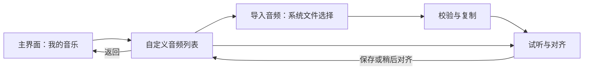

# 歌曲导入、BPM 与低延迟评分研究

日期：2026-10-11。研究分支：`codex/song-import-rhythm-research`。源码基线：`7fe6e5d`。

范围：分析玩家导入本地歌曲、输入 BPM、校准节拍，以及有效操作踩点加分的方案。本文不包含功能实现；未安装依赖、修改运行时代码或调整音频设置。下文数值是原型建议或计算示例，不是实机测试结果。

## 1. 可行性与第一版范围

固定 BPM 歌曲的导入和节奏奖励可沿现有架构扩展。优先实现本地导入、BPM／首拍对齐、输入时间戳、有效动作奖励和设备校准。自动识别复杂节奏、分段变速、高质量自动谱面及原生音频后端放在后续阶段。

低延迟分为三项：

- 判定误差：用输入事件时间和音乐时钟计算，减少帧率、逻辑步进和动作缓冲的影响。
- 视觉响应：受输入处理、60 Hz 战斗步进和渲染影响。准确的判定不等于动作立即显示。
- 音频响应：受 Unity／系统／输出设备缓冲影响。校准能补偿相对稳定的偏差，不能消除即时音效的物理延迟。

验收应绑定目标平台与设备，不能承诺所有蓝牙耳机或所有手机具有统一的低延迟。

## 2. 当前项目依据

路径均相对于项目根目录。

| 已确认事实 | 源码依据 | 接入影响 |
| --- | --- | --- |
| Unity 2022.3.62f1c1，Input System 1.14.2 | `ProjectSettings/ProjectVersion.txt`、`Packages/manifest.json` | 使用当前版本 API，并验证目标构建后端 |
| 音乐通过 `dspTime + 0.1` 和 `PlayScheduled` 启动 | `Assets/Scripts/Danmaku/Runtime/Audio/RuntimeMusicBackend.cs` | 已有调度基准；100 ms 是启动提前量，不是每次输入的固定延迟 |
| 时间轴每帧读取 `timeSamples / frequency` | `Assets/Scripts/Danmaku/Runtime/Audio/MusicTimelineTransport.cs` | 保留音乐驱动逻辑；增加任意输入时刻的歌曲时间换算 |
| Sequence 已有 BPM、首拍偏移、音乐相对战斗开始偏移 | `Assets/Scripts/Danmaku/Runtime/DanmakuSequence.cs` | 区分三者语义，不能把设备校准混入歌曲首拍 |
| 手动节拍网格位于 Editor 目录 | `Assets/Scripts/Danmaku/Editor/ManualMusicBeatGrid.cs` | 提炼不依赖 Editor 的节拍数学，供运行时使用 |
| 输入队列只存操作枚举，消费时合并按钮边沿 | `Assets/Scripts/System/Runtime/SystemInputRouter.cs` | 增加事件时间、命令 ID；不能只用合并后的边沿计分 |
| 战斗为 60 Tick/s，输入策略默认缓冲 8 Tick | `DanmakuSequence.cs`、`Assets/Scripts/Player/Runtime/PlayerActionTypes.cs` | 一 Tick 约 16.67 ms；默认缓冲覆盖约 133 ms，评分需保留原始输入时刻 |
| 动作已有接受执行事件和决策记录 | `Assets/Scripts/Player/Runtime/PlayerRuntime.cs` | 关联原始命令与执行结果；被拒绝的动作不奖励 |
| 评分使用统计快照和独立公式 | `Assets/Scripts/System/Runtime/ScoreManager.cs` | 新增节奏统计和评分公式，复用结算链路 |
| 歌曲选择页直接绑定资产歌曲数组 | `Assets/Scripts/System/UI/SongSelectView.cs` | 增加持久自定义目录及统一歌曲查询入口 |
| 歌曲长度决定战斗结束时间，弹幕来自编排 Sequence | `Assets/Scripts/Danmaku/Runtime/Battle/BattleSimulation.cs` | 导入音频不会自动生成对应长度的弹幕 |
| 补步超过预算时暂停音乐等待追齐 | `Assets/Scripts/Danmaku/Runtime/Battle/BattleManager.cs` | 补步暂停／恢复期间需明确输入归属，重建时钟映射 |
| 音频配置包含 `m_DSPBufferSize: 1024`、`m_RequestedDSPBufferSize: 0` | `ProjectSettings/AudioManager.asset` | 不能从序列化值推断真机延迟，需读取实际配置并实测 |

现有 `MusicAnalysisJob` 位于 Editor 目录；起音候选点不等于固定 BPM 或稳定拍点。第一版手动 BPM 不依赖全曲频谱分析。

## 3. 导入与持久数据

流程：选择文件 → 校验 → 复制到持久目录 → 加载并读取实际音频信息 → 输入 BPM／首拍 → 试听对齐 → 保存目录 → 进入自定义歌曲模式。

建议持久数据与运行时对象分开：

- JSON 保存版本、稳定歌曲 ID、相对文件位置、音频内容哈希、标题、BPM、首拍秒数、节拍细分和关卡模板版本。
- 运行时加载 `AudioClip`，创建每局独立配置，适配现有 Song／Battle／Sequence 链路。不要将导入数据写回内置配置资产。
- 歌曲目录查询和开局验证统一支持内置／自定义来源，避免只修改列表显示却无法开局或结算。
- 设备校准按输入方式／输出设备档案保存，不作为音频本身的首拍设置。

文件选择成功不代表音频可解码。校验应涵盖实际格式、文件大小、时长、声道和有效 BPM／偏移；失败时不给目录写入半成品。支持取消选择、复制或加载失败、重复文件、原文件移走、重启恢复和删除歌曲后的音频释放。

桌面路径需正确构造文件 URI，覆盖中文、空格及特殊字符；移动端通过文档提供者取得的资源需按插件接口复制到可持久访问的位置。第一版主张本地文件，不依赖联网播放。

音频解码在开局前完成或预缓冲，避免战斗中做文件读取或整曲分析。只加载当前歌曲。若使用 float PCM 全量解码，3 分钟、48 kHz、双声道的一份样本约为 `180 × 48000 × 2 × 4 = 69.12 MB`；临时数组和 AudioClip 会提高峰值。长曲流式加载应单独评估。

## 4. 节拍数学与对齐

固定 BPM 模型：

```text
P = 60 / BPM
beat(n) = firstBeatSeconds + n * P
```

使用 double 从起点与拍号计算，避免不断加周期或累计整数 Tick。只允许实际音乐范围内的拍点，首拍之前和歌曲结束之后不产生奖励。细分拍需要进入规则配置，例如八分音符周期为 `P / 2`。

BPM 决定周期，首拍偏移决定相位，MusicStartSeconds 决定音乐相对战斗时间轴的位置。评分以歌曲秒数为坐标，避免重复应用战斗偏移。

建议 UI 支持小数 BPM、节拍器试听、首拍微调、开头／后段跳转试听。推荐常用范围可以较窄，但参数合法性与产品支持范围分别定义。

- 全曲偏移近似恒定：调整首拍或设备校准，先明确误差来自歌曲还是设备。
- 误差逐渐增大：调整 BPM。
- 某段突然错位：检查变速、停顿或自由节奏，后续采用分段 BPM／显式拍点。

示例：真实 155 BPM 填成 156 BPM，约两分钟后对应拍点相差 0.77 秒；填成 155.1 BPM 相差约 77 ms。固定 BPM 方案不能保证变速歌曲整曲准确。

## 5. 输入时钟与播放生命周期

建议独立保留带时间戳的命令记录：命令 ID、动作类型／槽位、输入事件时间、播放段 ID、初步拍点与误差，以及接受／拒绝结果。持续状态仍可服务现有战斗模拟；评分不能从布尔状态推导重复按键。

`CallbackContext.time` 通常来自触发动作的输入事件时间，基于 realtime 时间域；`dspTime` 属于音频时间域，不能直接相减。应在回调内复制字段，不保留 CallbackContext 本身。[Input System 1.14 文档](https://docs.unity3d.com/Packages/com.unity.inputsystem@1.14/api/UnityEngine.InputSystem.InputAction.CallbackContext.html)

正常连续播放段可建立输入时钟到 DSP 时钟的映射，再以该段的计划启动 DSP 时间和起始采样位置换算歌曲时间。概念上：

```text
inputDsp = mapInputClockToDsp(inputEventTime)
songSeconds = segmentStartSample / clipFrequency
              + inputDsp - segmentScheduledStartDsp
```

这是架构示意，不是已验证算法。双时钟采样误差、漂移、音频缓冲和设备偏差需在目标设备测量。`timeSamples` 可用于播放状态与一致性检查；不得把每帧读数当成任意历史输入时刻的精确位置。DSP 时钟基于音频处理采样，适合音乐调度。[Unity DSP 时间文档](https://docs.unity3d.com/2022.3/Documentation/ScriptReference/AudioSettings-dspTime.html)

播放生命周期必须区分预调度、正常播放、暂停、Seek／恢复、后台挂起、设备重置和结束。每次新播放段建立新基准；暂停前迟到的输入不能用恢复后的映射解释。保留足够的播放段信息，或按明确规则丢弃过期输入。

用户暂停和战斗补步暂停应清理或隔离输入，禁止暂停期间积累奖励。恢复时明确是否倒计时，并与现有音乐等待启动状态一致。设备切换后重新确认音频配置并提示使用适当的校准档案。

## 6. 判定、有效动作和评分

先用校准后的输入歌曲时刻寻找最近合法拍点，记录有符号误差；动作确认接受后结算，避免在冷却、资源不足或被拒绝时刷分。动作缓冲期间保留原始输入时间，并对过期命令和重复命令设明确规则。

原型参数：Perfect `|error| ≤ 40 ms` 加 30 分；Good `40 < |error| ≤ 90 ms` 加 15 分；其他操作沿用基础评分。数值需试玩调整。窗口小于相邻有效拍点间隔的一半，处理高 BPM／细分拍的重叠和边界归属。

建议第一版支持跳跃、冲刺、技能。若纳入射击，增加明确的按下事件；持续长按产生的自动射击不能逐颗拿踩点分。连续移动和飞行暂不纳入。

防重复规则：每个命令最多奖励一次；每拍明确奖励上限和跨动作规则；被拒绝／过期不奖励；暂停、开始前和结束后不奖励。失败后是否允许同拍重试，应由单一规则定义。

新增统计可包含 Perfect、Good、有效尝试数、节奏奖励总分和早／晚误差分布，接入独立 ScoreFormula 与结算展示。第一版可以只奖励踩准操作，不增加拍外扣分；评级阈值要随额外分数重新评估。

若未来采用“踩点射击提升击碎得分”，把输入判定关联到射击批次／子弹，命中后兑现。不能直接用能量球被击碎的时刻代表玩家操作时刻；也不能让一次踩点散射无限复制奖励。

成绩规则建议：自定义歌曲与内置歌曲分开；音频哈希、BPM、首拍、细分、模板与评分版本共同决定可比较的规则版本。设备校准不改变谱面身份。跨歌比较采用准确率或归一化分数，不能直接比较可累积的总分。修改 BPM 后不覆盖旧规则最高分。

## 7. 自定义歌曲对应的弹幕

只替换音乐会改变结束时间，不会生成新的弹幕。第一版采用节拍驱动模板：每若干拍发射、每若干小节切换、按难度限制弹量与能量球数量、固定随机种子和规则版本。

把节拍转换为 60 Hz 关键帧时，每个事件独立舍入，避免积累误差。碰撞与发射保持现有模拟节奏；输入评分仍使用精确时间。模板生成需处理短曲、长曲、高 BPM 和容量限制，并控制长曲配置体积。

节拍模板只提供基本节奏关联，不宣称理解音乐段落或情绪。起音分析、自动变速检测和复杂谱面作为后续独立功能研究。

## 8. 现成方案取舍

| 环节 | 候选 | 建议 |
| --- | --- | --- |
| 桌面文件对话框 | [UnityStandaloneFileBrowser](https://github.com/gkngkc/UnityStandaloneFileBrowser) | 支持 Windows／Mac／Linux 和运行时；需验证目标构建，不能假设 Windows Async 接口一定非阻塞 |
| Android／iOS 文件选择 | [UnityNativeFilePicker](https://github.com/yasirkula/UnityNativeFilePicker) | 使用系统文档提供者；其他平台不支持，按插件接口处理资源复制 |
| 音频加载 | [UnityWebRequestMultimedia.GetAudioClip](https://docs.unity3d.com/2022.3/Documentation/ScriptReference/Networking.UnityWebRequestMultimedia.GetAudioClip.html) | 优先验证自带加载链路，逐平台测试 WAV／OGG／MP3；扩展名不等于解码能力 |
| MP3 解码备用 | [NLayer](https://github.com/naudio/NLayer) | C#、MIT，文档列出 Unity；选择兼容目标程序集，验证 IL2CPP、耗时和峰值内存 |
| OGG 解码备用 | [NVorbis](https://github.com/NVorbis/NVorbis) | 作为独立 Ogg Vorbis 解码候选，按需求评估，不预先引入 |
| 音乐同步／事件编排 | [Koreographer](https://www.koreographer.com/koreographer) | 可作为成熟工具候选；现有固定 BPM 需求可直接扩展，不将其视为完整导入／自动关卡方案 |

第一版不需要全曲 FFT 或自动 BPM 识别。文件选择、解码、同步、节拍判定和关卡生成是不同环节，不能靠一个文件选择插件完成。

若 Android 实测音频响应不达标，再评估 Oboe 原生后端；它会增加平台桥接与音频管理成本。官方建议低延迟模式、合理缓冲、输出回调和设备适配，测量结果受设备影响。[Android 低延迟音频指南](https://developer.android.com/games/sdk/oboe/low-latency-audio)

Unity 缩小 DSP 缓冲可能降低延迟，也会提高 CPU 成本和欠载风险；应读取实际缓冲、采样率并测量，不能只改设置后承诺延迟。[Unity GetDSPBufferSize 文档](https://docs.unity3d.com/2022.3/Documentation/ScriptReference/AudioSettings.GetDSPBufferSize.html)

## 9. 实施顺序与验证计划

| 阶段 | 交付 | 主要验收 |
| --- | --- | --- |
| A：导入与对齐 | 持久歌曲目录、加载、BPM／首拍、节拍器试听 | 中文路径、取消、失败、重复文件、重启恢复；开头和后段对齐 |
| B：时间与评分 | 时间戳、播放段映射、有效动作关联、去重、统计结算 | 同一时间戳输入在不同渲染帧率下判定一致；边界、缓冲、拒绝和长按规则 |
| C：模板与设备 | 节拍弹幕模板、校准档案、生命周期处理 | 长短曲、高弹量、暂停／恢复、后台／设备切换、目标平台音频与视觉响应 |

数学验证覆盖小数 BPM、首拍、音频边界、细分拍和最近拍点窗口；规则验证覆盖重复命令、同拍多动作、迟到输入和射击关联。将判定算法精度、输入到画面响应、输入到音效响应分别记录，报告中提供采样数量、分位数和输出设备，避免用单次平均值代表体验。

用模拟带时间戳输入验证帧率独立性；用实际输入和外部录音／录像或回环设备验证端到端响应。60／120 FPS 只是可选择的目标测试场景，30 FPS 和人为卡帧作为压力条件。先确认目标机稳定表现，再确定可承诺的延迟指标。

本次未运行上述验证。待明确的产品选择：首发桌面或移动端、支持格式、曲长限制、哪些动作计分、同拍奖励上限、自定义歌曲奖励／排行榜政策、变速歌曲支持范围。它们影响实施范围，但不阻碍固定 BPM 原型的技术方案确定。

## 10. 导入与对齐交互草案（2026-10-11，待确认）

### 10.1 用户已给出的方向与本轮边界

主界面增加一个小入口，点击后进入玩家自己导入的音频列表。本轮细化导入、列表和对齐方案，与用户确认后再决定实现。入口文案、具体位置、平台和文件格式尚未最终确认。

建议入口文案“我的音乐”，放在主菜单下方或右下角，用较小的图标加文字按钮。仍需足够的点击区域、键盘／手柄导航和可见焦点，不以极小点击区域实现“小入口”。进入时不要求已有游戏进度，不触发开始新游戏或重置存档。

### 10.2 页面流程



建议以现有主界面的 UI 页面切换承载列表和对齐页，暂不增加独立 Unity 场景。项目已有 `MenuView`、`SystemUIController` 和 UIContext，可扩展对应页面与返回行为；方案未写入这些代码或 prefab。

列表仅显示用户导入曲目。上方放标题“我的音乐”和“导入音频”；列表显示名称、时长、BPM、状态“待对齐／已设置”；选中曲目后提供试听、对齐、重命名和移除。空列表显示“还没有导入音乐”及导入按钮。操作失败保留列表原选择，返回主界面后再次进入恢复选中项和滚动位置。

本轮导入／对齐原型不开放未完成的“开始游戏”入口。后续弹幕模板和战斗接入完成后，再增加“使用此曲”，进入准备流程。

### 10.3 导入行为

建议第一版单曲导入。MP3、WAV 优先验证，OGG 视目标平台补充；目标平台等待用户选择，不将 Windows 建议视为已经确认。

1. 打开系统文件选择器，取消即回到原列表。
2. 校验、复制到应用持久目录，并读取实际音频信息；展示可读的加载进度或忙碌状态，避免重复导入。
3. 成功后创建“待对齐”条目，名称默认取文件名，自动进入对齐页。导入成功与用户确认对齐是两个独立状态。
4. 用户可选择“稍后对齐”，保留音频和条目。未设置 BPM 时仍可试听，暂不能参与节奏玩法。
5. 重复音频通过内容标识提示已有条目并定位；重新导入丢失文件用于修复条目，不默默生成多份副本。

只保存本局／试听需要的音频对象。试听停止、返回列表、进入其他页面或切换曲目时停止前一曲，防止两份音乐叠播；原有菜单音乐若存在，需要明确临时压低或暂停的恢复策略。

应用内移除只影响应用保存的副本和条目，不删除玩家原始文件。建议通过现有确认对话框说明范围；是否保留历史成绩待后续规则确认。自定义库独立于游戏进度文件，建议“开始新游戏”重置进度时保留库。

### 10.4 对齐页布局与参数

主区域显示整曲位置条及可缩放的局部波形，叠加 BPM 拍线；底部提供播放／暂停、拖动定位、节拍器开关和音量。右侧集中放 BPM、首拍位置、偏移微调以及保存按钮。波形来自实际加载音频，采用降采样摘要，不在每帧扫描整曲样本。

建议首版对齐步骤：

1. 输入 BPM（支持小数）；输入无效值时显示提示，不用一个假定 BPM 覆盖未设置状态。
2. 在局部波形上点击明确的节拍瞬态，标记为第一拍。首拍以歌曲时间保存，允许精确数值编辑。
3. 叠加节拍器试听；提供“拍线提前／延后”按钮，初始步长可用 10 ms，精调 1 ms。数值正方向统一表示首拍在文件中更晚。
4. 跳到中段和后段试听：恒定错位优先改首拍，逐渐漂移优先改 BPM；界面使用这两条简单说明引导。
5. 点击“保存对齐”，写入元数据并回列表；已导入条目编辑期间先保留草稿，取消时恢复已保存参数。有未保存修改时返回需明确“保存／放弃／继续编辑”。

第一版建议先做手动 BPM 和波形首拍标记。拍击测速可作为后续辅助，只估计 BPM，不能用人的反应时间可靠地确定精确首拍。“已设置”只表示玩家已保存有效配置，不宣称系统自动证明整曲对齐。

节拍器应与歌曲使用同一个播放基准进行音频调度，不能每帧到拍点才触发音效。视觉拍线可以每帧渲染，评分和节拍器时间不依赖显示帧率。拖动定位／循环试听重新建立播放段；负向时间、曲尾和预调度状态不误触发拍点。

固定 BPM 第一版无需拍号输入；默认逐拍提示。分段 BPM／变速支持后续再设计。试听页不单独塞入设备校准参数，避免把耳机延迟保存成每首歌曲的首拍；第一版设置入口可暂留整体校准方案，验收时使用同一设备核对。

### 10.5 导入／对齐验收与待确认项

- 主界面入口进入自己的音频列表；空列表、已有列表及无进度存档都可进入。
- 取消选择、坏文件、复制失败、解码失败不产生可见半成品；成功导入可稍后对齐。
- 重启可恢复条目、有效配置和音频；原文件移动不影响已复制的副本。
- 切歌／离开页面停止试听；波形和节拍器定位一致，Seek 和暂停恢复没有累计漂移。
- 保存与取消行为明确，BPM 和首拍可再次编辑，合法性与“用户已设置”分别处理。
- 同一加载音频的 44.1／48 kHz、MP3／WAV 在开头和后段核对节拍；这属于待执行验证。

待用户确认：首发平台；“我的音乐”入口与独立列表方案；是否保留“待对齐”条目；首版是否按“手动 BPM＋波形标首拍＋节拍器试听”实施。上述文案、布局与格式是建议，未作为已批准的实现。

## 11. 工作区改动审查（2026-10-11 快照，不是清理执行记录）

本轮审查时研究分支相对 master 只有本文和 `.meta`。其余未提交文件在创建研究分支前已存在；新建分支不会自动隔离或清除同一工作区的未提交内容。

已跟踪但未提交的三个文件：

| 路径 | 实际差异 | 建议 |
| --- | --- | --- |
| `.idea/.idea.TapTap_GameJam/.idea/MarsCodeWorkspaceAppSettings.xml` | 工具进度值由 1.0 变为 0.41 | 可恢复到仓库版本，不影响玩法 |
| `UserSettings/EditorUserSettings.asset` | 最近使用场景顺序交换 | 可恢复，不删除整个文件；会放弃这次个人状态变化 |
| `UserSettings/Layouts/default-2022.dwlt` | 窗口大小、停靠、活动面板等，共 258 行差异 | 可恢复，但会放弃当前布局变化；运行中的 Editor 可能再次写回 |

未跟踪项：

- `.idea/.idea.TapTap_GameJam/.idea/indexLayout.xml`：IDE 索引／工作区状态，可移除，工具可能再生成。
- `Assets/Scripts/Danmaku/Editor/DanmakuDeletionVerificationSession.cs` 及 `.meta`：临时删除验证脚本，需请求文件存在才执行；成功后自删的设计表明它是一次性辅助。日志已有 PASS，属于不同文本版本的结果，不能据此宣称当前脚本再次验证通过。建议移除前保存脚本和既有验证日志。
- `tmp/`：约 38,608 个实际文件、2.392 GiB；Git 可见未跟踪文件约 38,075 个，计数差来自忽略规则。不是 3.8 万处玩法修改。
- 其中 `tmp/run-validation/Library/` 有 35,342 文件、约 2,112.8 MiB，是验证副本的可重建 Unity 缓存，约占 tmp 体积的 86%。
- 其余含编译产物、验证项目／测试源码、截图、日志和 `tmp/music-presentation-compile/ui-before/` 的旧 prefab／场景备份。尚未逐个确认它们都可丢弃，不建议整目录直接删除。

审查时主项目 Unity Editor 正在运行，未观察到打开 tmp/run-validation 的 Unity 进程。任何实际删除前仍需重新检查占用和目录边界。

推荐清理范围（等待明确授权）：恢复上述三个已跟踪的个人状态改动；移除 IDE 的未跟踪 indexLayout；备份后移除一次性验证脚本及 meta；只删除验证副本的 Library 缓存；保留 tmp 其余源码、结果和旧资产备份。为减少 Git 噪音，可单独加入 `/tmp/` 忽略规则，但该规则不会释放磁盘空间。

已经跟踪的 UserSettings／IDE 文件仅追加忽略规则并不会停止追踪；是否从版本管理移除属于另一项仓库整理决定。本轮没有恢复、删除、取消追踪或修改 `.gitignore`。
